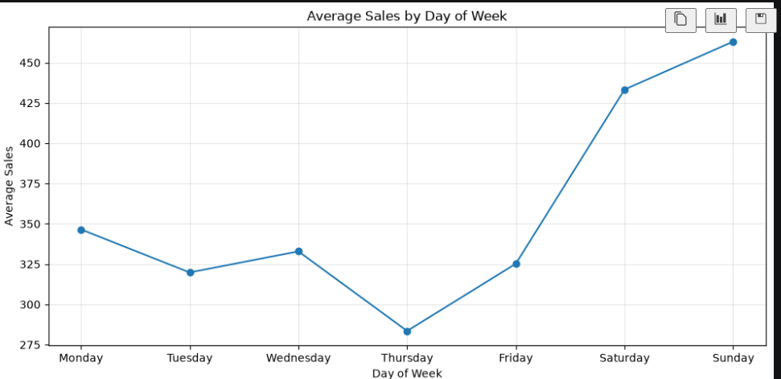
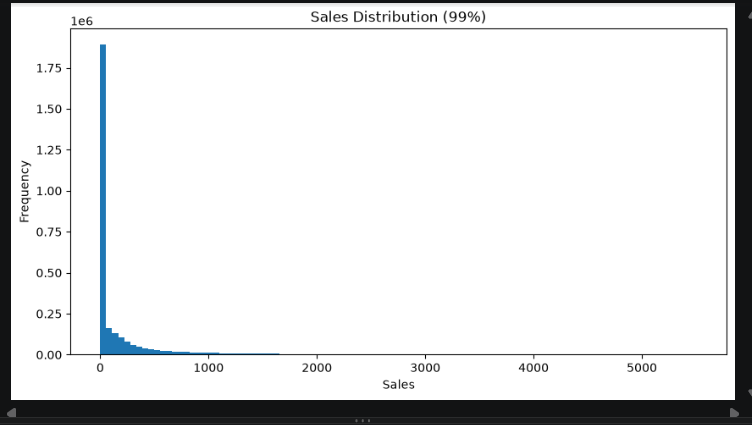
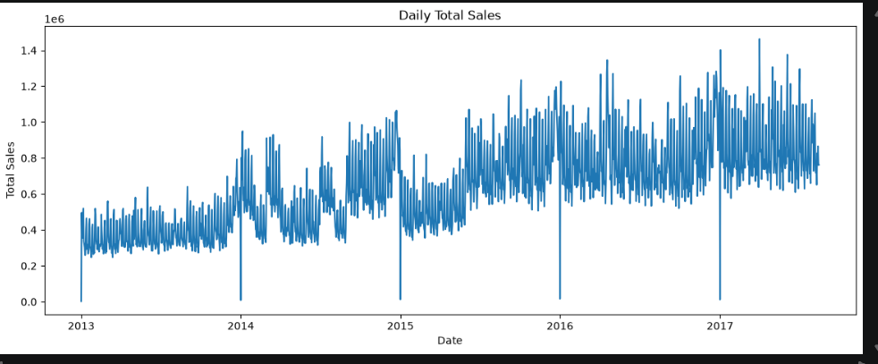
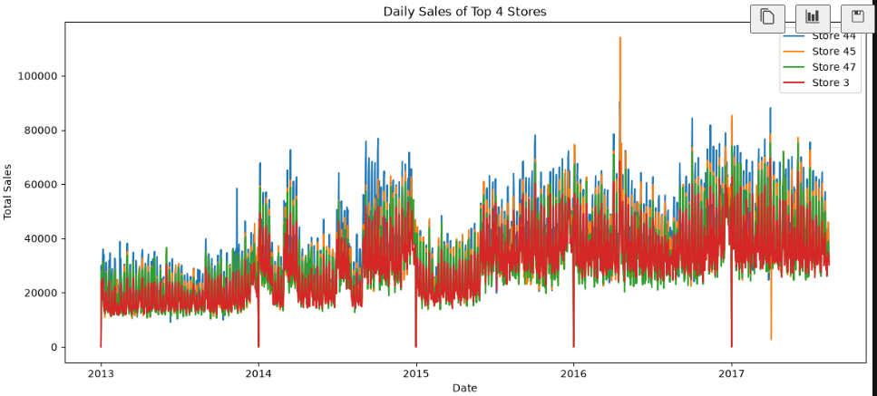
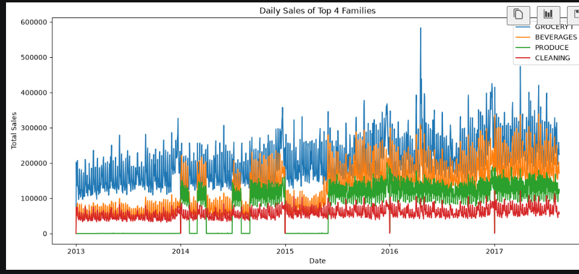
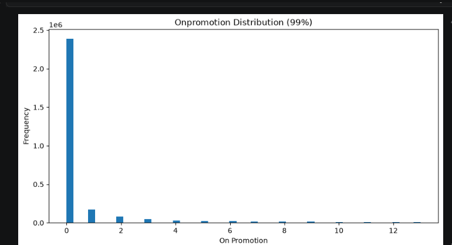
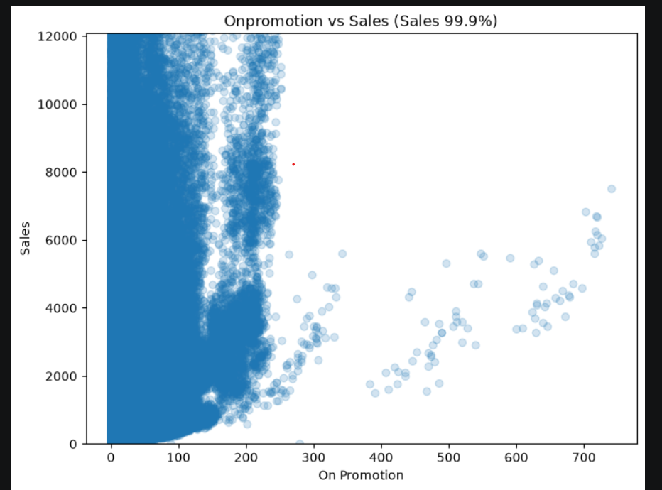
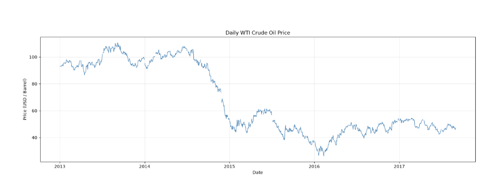

# EDA

> 초기 `train`·`stores`·휴일·이벤트 EDA를 마무리한 후, **Day12(2026-10-19)에 외부 보조 데이터인 `oil.csv`와 `transactions.csv`를 추가 탐색**했다. 기존 EDA 결과를 보존하면서 데이터의 날짜 공백, 결측 원인, 처리 근거 및 예측 시점 정보 가용성을 별도로 기록한다. 모델링에서 이상한 결과가 발견되면 해당 부분만 다시 EDA로 돌아와 보완한다.

## 데이터 구조

`train.csv`의 기본 구조를 확인했다.

```text

id           int64

date         str

store_nbr    int64

family       str

sales        float64

onpromotion  int64

```

전체 학습 데이터는 약 **300만 행**으로 구성되어 있다.

한 행은 기본적으로

> **특정 날짜(date) × 특정 매장(store_nbr) × 특정 상품군(family)의 판매량**

을 의미한다.

`store_nbr`는 판매량이나 매장 규모를 의미하는 수치형 변수가 아니라 **매장 ID**이다. 데이터에는 1번부터 54번까지의 매장이 존재한다. 수치형으로 저장되어 있어도 ID이므로 평균·표준편차 같은 통계값 자체는 의미가 거의 없다.

`family`는 개별 제품이 아니라 `GROCERY I`, `BEVERAGES`, `PRODUCE`, `CLEANING` 등과 같은 **상품군**이다.

새 데이터셋을 받았을 때의 기본 확인 루틴으로 다음을 사용했다.

```python

train.shape

train.head()

train.info()

train.isnull().sum()

train.describe()

train.nunique()

```

- `nunique()`는 각 컬럼에 서로 다른 값이 몇 종류 있는지, `unique()`는 실제 값의 종류가 무엇인지 보여준다.

- `describe()`의 `e+06`, `e+07`, `e+08` 같은 과학적 표기법은 각각 백만, 천만, 억 정도의 감각으로 읽는다.

이번 `train.csv`에서는 **결측치가 발견되지 않았다.**

다만 결측치가 없다고 데이터 전처리가 필요 없는 것은 아니다. `sales = 0`, `onpromotion = 0`, 극단적으로 큰 판매량, 날짜에 따른 패턴 등이 더 중요한 특징으로 보였다.

시계열 분석을 위해 `date`를 문자열에서 datetime 형태로 변환했다.

```python

train["date"] = pd.to_datetime(train["date"])

test["date"] = pd.to_datetime(test["date"])

```

또한 이 데이터는 하나의 시계열이라기보다,

> **매장 × 상품군마다 각각 하나의 판매량 시계열이 존재하는 패널 시계열**

형태로 이해했다.

**---**

## 날짜 구조 및 예측 구간

시계열 문제이므로 `train`과 `test`의 날짜 경계를 먼저 확인했다.

```python

print("Train:", train["date"].min(), "~", train["date"].max())

print("Test :", test["date"].min(), "~", test["date"].max())

print("Prediction days:", test["date"].nunique())

```

날짜 범위는 다음과 같다.

\| 구분 | 기간 |

\|---|---|

\| Train | 2013-01-01 ~ 2017-08-15 |

\| Test | 2017-08-16 ~ 2017-08-31 |

\| 예측 기간 | 16일 |

즉 이 대회에서는 학습 데이터 마지막 날짜 직후의 **16일을 예측**한다.

날짜가 매일 연속되어 있다고 가정하지 않고 실제로 빠진 날짜도 확인했다. `train`에는 일부 날짜가 존재하지 않으며, 특히 2013~2016년의 **12월 25일(Christmas)**이 빠져 있다. 따라서 날짜 인덱스를 만들거나 lag/rolling feature를 생성할 때 단순히 행 번호만 기준으로 처리하면 안 되고 실제 날짜 간격을 고려해야 한다.

요일 정보도 날짜에서 추출할 수 있다.

```python

train["dayofweek"] = train["date"].dt.dayofweek

train["day_name"] = train["date"].dt.day_name()

```

`dayofweek`는 월요일부터 일요일까지 `0~6`의 정수로 표현하고, `day_name()`은 `Monday`, `Tuesday`처럼 사람이 읽기 쉬운 요일 이름을 반환한다.

요일별 평균 판매량도 확인했다.



단순 평균 기준으로는 **목요일의 평균 판매량이 가장 낮고, 주말인 토요일과 일요일에 판매량이 크게 높아지는 패턴**이 나타났다. 특히 일요일의 평균 판매량이 가장 높았다.

따라서 `dayofweek`는 판매량 예측에서 의미가 있을 가능성이 높은 시간 feature 후보로 보인다. 다만 이 그래프는 전체 기간의 단순 평균이므로 장기 추세, 공휴일, 프로모션 등 다른 요인의 영향도 섞여 있을 수 있다.

이번 EDA에서는 요일 효과의 존재 가능성을 확인하는 수준에서 마무리하고, 실제 성능 기여 여부는 모델링 과정에서 검증하기로 했다.

**---**

## Target 분석

Target은 `sales`이다. 반드시 정수 개수를 뜻하는 것은 아니고, 무게 단위로 판매되는 상품 때문에 소수값도 가능하다.

`describe()` 결과 주요 값은 다음과 같았다.

\| 통계 | Sales |

\|---|---:|

\| 평균 | 약 358 |

\| 25% 지점 | 0 |

\| 중앙값 | 11 |

\| 75% 지점 | 약 196 |

\| 최대 | 약 12만 5천 |

평균이 약 358인데 중앙값은 11밖에 되지 않는다. 평균과 중앙값 차이가 크면 일부 큰 값이 평균을 끌어올리고 있을 가능성을 의심할 수 있다.

따라서 대부분의 판매량은 비교적 작은 값에 몰려 있고, 일부 매우 큰 판매량이 평균을 크게 끌어올리고 있다고 판단했다.

또한 25% 지점이 0이므로 **판매량 0도 상당히 많이 존재한다.**

`sales`의 분위수도 `quantile()`로 확인했다.

\| 범위 | Sales |

\|---|---:|

\| 90% | 867 이하 |

\| 95% | 1965 이하 |

\| 99% | 5507 이하 |

\| 99.9% | 약 1만 2076 이하 |

최대값은 약 12만 5천이지만 **99%의 데이터는 약 5500 이하**라는 점에서 극단적인 큰 값이 소수 존재한다는 것을 확인했다.

히스토그램은 x축이 값의 구간, y축이 해당 구간의 데이터 개수를 나타낸다. 전체 범위로 히스토그램을 그렸을 때는 극단값 때문에 대부분의 데이터가 0 근처에 눌려 보였다.

그래서 99%, 95%, 90% 구간으로 범위를 좁혀 확인했다. 이렇게 범위를 잘라 보는 것은 데이터를 삭제하는 것이 아니라, EDA에서 대부분의 데이터가 어떻게 생겼는지 확대해서 보는 것이다.



특히 범위를 좁혀 보았을 때도

> **0 및 낮은 판매량에 데이터가 매우 많이 몰려 있고, 판매량이 커질수록 빈도가 급격히 감소하지만 큰 값들이 오른쪽으로 계속 존재**

하는 모습을 확인했다.

분포의 치우친 방향은 데이터가 몰린 방향이 아니라 꼬리가 뻗은 방향으로 이름 붙인다. 따라서 `sales`는 **오른쪽 꼬리가 매우 긴 강한 right-skewed 분포**를 가진다고 판단했다.

**---**

## 시계열 패턴

전체적인 판매량의 시간 흐름을 확인하기 위해 날짜별로 모든 매장과 상품군의 판매량을 합산했다.

```python

daily_sales = (

    train.groupby("date")["sales"]

    .sum()

    .reset_index()

)

```

이를 일별 시계열 그래프로 확인했다.



가장 먼저 확인된 특징은 **장기적인 상승 추세(trend)**였다.

2013년 초반보다 2016~2017년의 일별 전체 판매량 수준이 전반적으로 높아져 있었다. 따라서 시간의 흐름에 따라 전체 판매량 자체가 증가하는 trend가 존재한다고 판단했다.

또한 일별 판매량이 단순하게 증가하는 것이 아니라 비교적 규칙적으로 위아래로 반복되는 모습이 나타났다. 따라서

> **요일, 월, 계절 등과 관련된 주기성 또는 계절성이 존재할 가능성**

이 있다고 판단했다.

다만 아직 정확한 주기를 분석하지 않았으므로 특정 주간·월간 계절성이라고 확정하지는 않았다.

또 하나 특이한 점은 **특정 시점마다 전체 판매량이 거의 0 근처로 급락하는 날이 반복적으로 존재한다는 것**이었다.

초기 가설로는

> 휴일, 휴점, 특정 이벤트 또는 사건과 관련될 가능성

을 생각했다. 이 부분은 이후 `holidays_events.csv` 등의 보조 데이터와 날짜를 비교하여 검증할 수 있다.

특정 날짜에 모든 매장·상품군이 비슷하게 움직인다면 개별 항목보다 공통적인 시간 요인이 강할 가능성이 있다.

현재까지 시계열 EDA에서 가장 강하게 느껴진 특징은 다음과 같다.

> **매장이나 상품군 개별 특성 이전에 전체 데이터에 공통으로 작용하는 시간 패턴이 상당히 강해 보인다.**

**---**

## 매장별 분석

총 54개 매장을 전부 하나씩 분석하기보다는, 먼저 전체 규모를 확인한 뒤 대표적인 몇 개를 골라 깊게 보는 방식을 택했다. 우선 매장별 전체 누적 판매량을 확인했다.

```python

store_sales = (

    train.groupby("store_nbr")["sales"]

    .sum()

    .sort_values(ascending=False)

)

```

누적 판매량 상위 매장은 다음과 같았다.

\| 매장 | 누적 판매량 |

\|---:|---:|

\| 44 | 약 6209만 |

\| 45 | 약 5450만 |

\| 47 | 약 5095만 |

\| 3 | 약 5048만 |

\| 49 | 약 4342만 |

\| 46 | 약 4190만 |

\| 48 | 약 3593만 |

\| 51 | 약 3291만 |

이 중 상위 4개인 **44, 45, 47, 3번 매장**의 일별 판매량을 비교했다. 상위 매장을 보는 이유는 단순히 판매량이 많아서가 아니라, 전체 패턴이 개별 그룹에서도 유지되는지 확인하기 위해서이다.



흥미롭게도 네 매장의 시계열이 **전체 판매량 시계열과 상당히 비슷한 형태**로 움직였다. 장기적인 상승 추세뿐 아니라 특정 시기의 상승·하락도 대체로 함께 나타났다.

따라서 상위 매장에서는

> **매장 고유 패턴뿐 아니라 전체 시장에 공통적으로 작용하는 시간 효과도 상당히 강할 가능성**

이 있다고 판단했다.

특정 날짜에 판매량이 거의 0까지 떨어지는 현상도 반복적으로 나타났다.

다만 현재는 판매량 상위 4개 매장만 확인했으므로, 이를 모든 54개 매장의 공통 특성이라고 확정하지는 않았다. 상위 매장의 공통적인 흐름을 확인했다는 정도로 해석했다.

### 매장 메타데이터 추가 EDA — `stores.csv`

#### 탐색 배경과 범위

Day05 모델의 분할 횟수 기준 Feature Importance에서 `store_nbr`가 13,438로 가장 높았다. 매장 정보가 자주 사용된다는 점에서, 매장 ID 외에 위치·유형·유사 매장 그룹을 제공하면 도움이 될 수 있다는 가설을 세웠다. 다만 분할 횟수 자체가 성능 기여량은 아니며, 매장 ID가 중요하다고 메타데이터의 추가 효과까지 크다고 단정할 수는 없다.

또한 Regional / Local Holiday를 해당 매장에 연결하려면 `state`, `city`가 필요했다. 전체 EDA를 반복하기보다 매장 메타데이터의 분포와 변수 간 관계를 중심으로 추가 탐색했다.

\| 컬럼 | 의미 | 활용 방향 |

\|---|---|---|

\| `store_nbr` | 매장 식별자 | 판매 데이터와 연결하는 키 |

\| `city` | 매장이 위치한 도시 | 도시 특성과 Local Holiday 연결 |

\| `state` | 매장이 위치한 주 | 지역 특성과 Regional Holiday 연결 |

\| `type` | 매장 유형 | 같은 유형 매장들의 공통 특성 |

\| `cluster` | 유사한 매장의 그룹 | 유사 매장들의 공통 특성 |

`store_nbr`와 `cluster`는 숫자 크기에 의미를 두는 수치가 아니라 식별자·그룹 번호로 해석한다. 매장 `type`은 Holiday 데이터의 이벤트 종류인 `type`과 의미가 다르다.

#### city별 매장 수

\| city | 매장 수 |

\|---|---:|

\| Quito | 18 |

\| Guayaquil | 8 |

\| Cuenca | 3 |

\| Santo Domingo | 3 |

\| Latacunga | 2 |

\| Ambato | 2 |

\| Machala | 2 |

\| Manta | 2 |

\| Cayambe | 1 |

\| Babahoyo | 1 |

\| El Carmen | 1 |

\| Daule | 1 |

\| Ibarra | 1 |

\| Esmeraldas | 1 |

\| Loja | 1 |

\| Libertad | 1 |

\| Guaranda | 1 |

\| Playas | 1 |

\| Quevedo | 1 |

\| Puyo | 1 |

\| Riobamba | 1 |

\| Salinas | 1 |

\| **합계** | **54** |

54개 매장이 22개 도시에 분포한다. Quito와 Guayaquil에 26개, 전체의 약 **48.1%**가 집중되어 있다. 나머지 20개 도시는 각각 1~3개 매장을 포함하며, 그중 14개 도시는 매장이 하나뿐이다.

이는 **매장 수의 지역적 집중**을 보여주는 결과다. 판매량이 같은 비율로 집중되거나 해당 지역의 매장당 판매량이 높다는 뜻은 아니다.

Ambato에는 매장이 **2개** 있다. 앞서 확인한 Test 기간의 2017-08-24 Local 이벤트는 이 도시에 있는 두 매장에 적용할 대상이다. 해당 매장 번호 확인과 실제 Holiday 연결은 아직 다음 작업이다.

#### state별 매장 수

\| state | 매장 수 |

\|---|---:|

\| Pichincha | 19 |

\| Guayas | 11 |

\| Manabi | 3 |

\| Azuay | 3 |

\| Santo Domingo de los Tsachilas | 3 |

\| Los Rios | 2 |

\| El Oro | 2 |

\| Cotopaxi | 2 |

\| Tungurahua | 2 |

\| Esmeraldas | 1 |

\| Bolivar | 1 |

\| Chimborazo | 1 |

\| Imbabura | 1 |

\| Loja | 1 |

\| Pastaza | 1 |

\| Santa Elena | 1 |

\| **합계** | **54** |

매장이 16개 주에 분포하며, Pichincha와 Guayas에 30개, 전체의 약 **55.6%**가 모여 있다. 나머지 14개 주에는 각각 1~3개 매장이 있어 주 단위에서도 고르게 분포하지 않는다.

`state`는 지역 특성을 표현하는 피처 후보이면서 Regional Holiday 적용 대상을 구분하는 기준이다. 도시·주별 매장 수 표만으로 개별 도시와 주의 대응 관계나 지역별 판매 패턴까지 판단하지는 않는다.

#### type별 매장 수와 판단

\| type | 매장 수 |

\|---|---:|

\| D | 18 |

\| C | 15 |

\| A | 9 |

\| B | 8 |

\| E | 4 |

\| **합계** | **54** |

유형별 매장 수가 완전히 균등하지는 않지만 모든 유형에 여러 매장이 있다. 이를 보고 **같은 유형에 속한 매장들의 공통 특성을 학습하는 데 도움이 될 것**이라는 가설을 세웠다.

매장 ID가 개별 매장을 구분한다면 `type`은 여러 매장을 하나의 범주로 묶는 정보다. 다만 매장 수 분포만으로 같은 유형의 판매 패턴이 비슷하거나 피처 추가 시 성능이 개선된다고 확정할 수는 없다.

#### cluster별 매장 수와 판단

\| cluster | 매장 수 |

\|---|---:|

\| 3 | 7 |

\| 10 | 6 |

\| 6 | 6 |

\| 15 | 5 |

\| 13 | 4 |

\| 14 | 4 |

\| 1 | 3 |

\| 8 | 3 |

\| 4 | 3 |

\| 11 | 3 |

\| 9 | 2 |

\| 2 | 2 |

\| 7 | 2 |

\| 5 | 1 |

\| 12 | 1 |

\| 16 | 1 |

\| 17 | 1 |

\| **합계** | **54** |

54개 매장이 17개 클러스터에 속하며, 클러스터당 매장은 1~7개다. 매장이 하나인 그룹 4개와 두 개인 그룹 3개를 합쳐, **7개 클러스터는 매장이 1~2개뿐**이다.

이 결과를 보고 **작은 그룹이 개별 매장 ID에 비해 충분한 추가 정보를 제공하는지** 의문을 가졌다. 특히 단일 매장 클러스터는 여러 매장 사이의 공통 특성을 전달하기 어려울 수 있다.

다만 **매장 수가 적다고 학습 행 자체가 적다는 뜻은 아니다.** 각 매장에는 여러 날짜·상품군의 판매 기록이 있다. 따라서 작은 그룹이라는 이유만으로 제거하지 않고, 범주형 피처로 활용한 뒤 추가 효과를 검증하기로 했다.

#### type × cluster 교차표

개별 컬럼의 분포에 이어 두 분류가 얼마나 겹치는지 확인했다.

\| cluster | A | B | C | D | E |

\|---:|---:|---:|---:|---:|---:|

\| 1 | 0 | 0 | 0 | 3 | 0 |

\| 2 | 0 | 0 | 0 | 2 | 0 |

\| 3 | 0 | 0 | 7 | 0 | 0 |

\| 4 | 0 | 0 | 0 | 3 | 0 |

\| 5 | 1 | 0 | 0 | 0 | 0 |

\| 6 | 0 | 6 | 0 | 0 | 0 |

\| 7 | 0 | 0 | 2 | 0 | 0 |

\| 8 | 0 | 0 | 0 | 3 | 0 |

\| 9 | 0 | 0 | 0 | 2 | 0 |

\| 10 | 0 | 1 | 0 | 1 | 4 |

\| 11 | 3 | 0 | 0 | 0 | 0 |

\| 12 | 0 | 0 | 1 | 0 | 0 |

\| 13 | 0 | 0 | 0 | 4 | 0 |

\| 14 | 4 | 0 | 0 | 0 | 0 |

\| 15 | 0 | 0 | 5 | 0 | 0 |

\| 16 | 0 | 1 | 0 | 0 | 0 |

\| 17 | 1 | 0 | 0 | 0 | 0 |

**17개 클러스터 중 16개는 단일 타입으로 구성**된다. 클러스터 10만 B 1개·D 1개·E 4개로 혼합되어 있다.

처음에는 “대부분 같은 타입이 같은 클러스터네”라고 생각했지만, 정확히는 **같은 클러스터에 속한 매장들은 대부분 같은 타입**이라는 관계다. 반대로 A·B·C·D는 각각 여러 클러스터에 걸쳐 있고, E는 클러스터 10에만 속한다.

따라서 클러스터가 타입 내부의 세부 구분을 제공할 가능성이 있다. 하지만 혼합 클러스터가 있으므로 완전한 상하 관계는 아니다. **정보가 상당히 겹친다는 것과 완전히 같은 정보라는 것은 다르다.**

우선 `type`, `cluster`를 모두 활용하고, 이후 같은 기준 모델에서 하나씩 제거하는 Ablation으로 추가 효과를 확인하기로 했다. 새 피처를 평가할 때는 컬럼 수보다 **기존 피처에 비해 무엇을 더 알려주는가**가 중요하다.

#### 활용 방향과 현재 진행 범위

- `city`, `state`는 위치 정보를 제공하고 각각 Local / Regional Holiday 연결에 사용한다.

- `type`, `cluster`는 여러 매장이 공유하는 특성을 표현하되, 중복 정보 가능성을 함께 검토한다.

- 매장 정보는 `store_nbr` 기준으로 판매 데이터에 병합했고, 병합 후 `city`, `state`, `type`, `cluster` 결측치가 없음을 확인했다. 상세 병합·검증 내용은 전처리 문서에서 다룬다.

- 새 매장 컬럼 범주화, 지역 Holiday 실제 연결, 메타데이터 반영 후 재학습은 아직 다음 작업이다.

- 유형·클러스터별 판매량이나 시간 패턴을 비교한 결과는 이번 분석에 포함하지 않았다. 관측한 매장 수 분포와 모델링 가설을 구분한다.

**---**

## 제품군별 분석

33개 상품군도 전부 개별적으로 보기보다는 먼저 상품군별 누적 판매량을 확인했다.

주요 상위 상품군은 다음과 같았다.

\| 순위 | 상품군 | 누적 판매량 |

\|---:|---|---:|

\| 1 | GROCERY I | 약 3억 4346만 |

\| 2 | BEVERAGES | 약 2억 1695만 |

\| 3 | PRODUCE | 약 1억 2270만 |

\| 4 | CLEANING | 약 9752만 |

\| 5 | DAIRY | 약 6449만 |

\| 6 | BREAD/BAKERY | 약 4213만 |

\| 7 | POULTRY | 약 3188만 |

\| 8 | MEATS | 약 3109만 |

`PRODUCE`는 과일·채소 등의 **신선 농산물류**를 의미한다.

하위 상품군 중에서는 `BOOKS`, `BABY CARE`, `HOME APPLIANCES` 등의 전체 판매량이 매우 작았다. 따라서 상품군 사이의 판매 규모 차이가 상당히 크다는 것도 확인했다.

이후 상위 상품군의 날짜별 판매량 합계를 만들어 시계열로 비교했다.

상위 4개:

```text

GROCERY I

BEVERAGES

PRODUCE

CLEANING

```



추가로 상위 8개에서는 다음 상품군까지 포함해 비교했다.

```text

DAIRY

BREAD/BAKERY

POULTRY

MEATS

```

그래프를 확인하면서 식품·유제품 계열은 전체 판매량 변화에 비교적 민감하게 반응하며 함께 움직이는 모습이 보였다.

`CLEANING`은 상대적으로 안정적으로 유지되는 것처럼 보였지만, 자세히 보면 역시 전체적인 시간 변화 패턴과 비슷하게 움직이는 부분이 있었다.

따라서 상품군마다 절대 판매량과 변동 폭은 다르지만,

> **많은 상품군이 전체적인 시간 패턴의 영향을 공통적으로 받고 있다**

는 가설을 세웠다.

동시에 상품군마다 성격이 다르기 때문에 모델링에서는 다음을 함께 고려할 가치가 있다고 보았다.

- 전체적인 시간 패턴

- 상품군 고유 특성

- 상품군의 성격

- 특정 상품군만의 특수 변동

향후에는 상품군을 단순 ID로만 처리하기보다

> 식품 / 신선식품 / 생활용품 등과 같은 **거시적인 상품 성격**

을 활용할 가능성도 생각했다.

또 향후 모델링 결과 특정 상품군의 예측 성능이 유독 좋지 않다면 해당 상품군을 별도로 분석하여

> 특이한 시간 패턴 확인 → 관련 feature 추가 → ablation으로 실제 성능 개선 여부 확인

하는 방식도 고려할 수 있다고 판단했다.

반드시 거시 → 미시 순서의 별도 모델로 만들어야 하는 것은 아니며, 하나의 모델 안에서 공통 시간 feature와 상품군 정보를 함께 줄 수도 있다.

**---**

## 프로모션 영향

`onpromotion`은 광고 횟수가 아니다. 정확히는

> **해당 날짜 × 매장 × 상품군에서 프로모션 중인 개별 상품의 수**

이다.

`describe()` 결과 `onpromotion`은 25%, 50%, 75% 지점이 모두 0이었다.

실제로 다음 코드로 0의 비율을 확인했다. 조건식의 평균을 이용하면 특정 조건을 만족하는 데이터의 비율을 쉽게 계산할 수 있다.

```python

(train["onpromotion"] == 0).mean() \* 100

```

결과는 약 **79.6%**였다.

즉,

> **전체 데이터 약 5개 중 4개는 프로모션 상품 수가 0**

이다.

히스토그램에서도 0에 데이터가 압도적으로 많이 몰려 있었고, 1 이상부터 빈도가 빠르게 줄어들었다. 그러면서도 일부 큰 프로모션 값이 존재하여 `onpromotion` 역시 **오른쪽 꼬리가 매우 긴 분포**를 보였다.



이후 `onpromotion`과 `sales`의 관계를 확인하기 위해 산점도를 그렸다. 한 변수의 분포는 히스토그램으로, 두 수치형 변수의 관계는 산점도로 보는 것이 기본이다.

```text

x축 = onpromotion

y축 = sales

```

전체 범위에서는 극단적인 판매량 때문에 대부분의 점이 아래쪽에 눌려 보여, `sales` 99.9% 범위로 줄여 다시 확인했다.



- 프로모션 0 근처에 데이터가 워낙 많이 몰려 있어 이 구간에서는 명확한 관계를 판단하기 어려웠다.

- 대략 100~300 수준에서는 복잡하게 퍼지는 모습이 보였다.

- 프로모션 상품 수가 매우 큰 영역에서는 프로모션 수가 증가하면서 판매량도 함께 증가하는 듯한 신호가 일부 보였다.

하지만 이를

> **"프로모션을 많이 하면 판매량이 증가한다."**

라고 바로 해석할 수는 없다.

판매 규모가 원래 큰 상품군일수록 판매량도 많고 프로모션 대상 상품도 많을 수 있기 때문에, 산점도의 관계를 곧바로 인과로 해석하면 안 된다. 현재는 **상관관계의 신호가 일부 보인다** 정도로 판단했다.

**---**

## 휴일 및 이벤트 데이터

`holidays_events.csv`도 가볍게 확인했다. 이 데이터는 날짜별로 `type`, `locale`, `locale_name`, `description`, `transferred` 등의 정보를 제공한다.

분석을 위해 먼저 날짜를 datetime으로 변환했다.

```python

holidays["date"] = pd.to_datetime(holidays["date"])

```

날짜순으로 확인했을 때 같은 날짜에 여러 개의 지역 행사나 공휴일이 동시에 존재하는 경우가 있었다. 또한 `description`은 스페인어 이름이 많고, 같은 큰 이벤트도 여러 세부 이름으로 나뉘어 있었다.

예를 들어 Christmas는 다음과 같이 여러 날짜로 표현된다.

```text

Navidad-4

Navidad-3

Navidad-2

Navidad-1

Navidad

Navidad+1

```

따라서 EDA에서는 원래 `description`을 그대로 하나씩 해석하기보다, 의미가 비슷한 이벤트를 임시로 `event_group`으로 묶어 구조를 확인했다.

주요 그룹은 다음과 같았다.

\| event_group | count |

\|---|---:|

\| City Foundation | 80 |

\| Local Anniversary | 54 |

\| Independence Day | 41 |

\| Christmas | 40 |

\| Earthquake Event | 31 |

\| Other | 30 |

\| Provincial Anniversary | 24 |

\| New Year | 14 |

\| Carnival | 10 |

\| Mothers Day | 10 |

\| Labor Day | 5 |

\| Good Friday | 5 |

\| Cyber Monday | 3 |

\| Black Friday | 3 |

이 결과에서 지역 단위 행사인 `City Foundation`, `Local Anniversary`, `Provincial Anniversary`가 상당히 많다는 점이 눈에 띄었다.

또한 휴일은 단순히 `holiday = 0/1`로 처리하기 어려운 구조였다.

- `National`: 전국에 적용

- `Regional`: 특정 지역에 적용

- `Local`: 특정 도시 등에만 적용

- `Transfer`: 원래 공휴일이 다른 날짜로 이동된 경우

- `Bridge`: 연휴를 연결하기 위한 휴일

- `Work Day`: 휴일 이동 등으로 인해 대신 근무하는 날

특히 `locale`과 `locale_name`이 있기 때문에 **지역 공휴일을 모든 매장에 동일하게 적용하면 안 된다.** 이후 전처리에서는 `stores.csv`의 도시·지역 정보와 연결할 필요가 있다.

`transferred`는 해당 공휴일이 실제로 다른 날짜로 옮겨졌는지를 나타낸다. 따라서 단순히 `description`만 보고 휴일 여부를 결정하지 않고 `type`, `locale`, `transferred`를 함께 보는 것이 필요하다.

### Test 기간의 휴일 확인

실제로 예측해야 하는 `test` 기간에 해당하는 휴일만 필터링했다.

```python

test_start = test["date"].min()

test_end = test["date"].max()

test_holidays = holidays[

    (holidays["date"] >= test_start) &

    (holidays["date"] <= test_end)

].sort_values("date")

```

확인 결과 `holidays_events.csv`에서 test 기간에 직접 해당하는 항목은 다음 한 건이었다.

\| date | type | locale | locale_name | description | event_group | transferred |

\|---|---|---|---|---|---|---|

\| 2017-08-24 | Holiday | Local | Ambato | Fundacion de Ambato | City Foundation | False |

즉 **2017-08-24의 Ambato 도시 창립기념일**이며, 전국 공휴일이 아니라 `Ambato` 지역에만 해당한다.

따라서 모델링에서 이 날짜를 모든 매장에 동일한 공휴일로 표시해서는 안 되고,

> **2017-08-24 + Ambato에 위치한 매장**

이라는 조건으로 적용하는 것이 자연스럽다.

이번에 만든 `event_group`은 휴일 데이터를 이해하기 위한 **EDA용 단순화 그룹**이다. 실제 모델에서 그대로 feature로 사용할지는 전처리와 검증 과정에서 결정한다.

**---**

## 유가 데이터 추가 EDA — `oil.csv` (Day12)

### 탐색 배경과 데이터 구조

`oil.csv`는 날짜별 유가 정보를 제공하는 **외부 시계열 데이터**다. 판매 데이터에 날짜 기준으로 결합하면 원유 가격 변화와 판매량의 관계를 모델이 활용할 수 있을지 실험할 수 있다. 다만 **유가가 판매량에 실제로 도움이 되는지는 아직 검증하지 않았다.**

| 컬럼 | 의미 | 특징 |
|---|---|---|
| `date` | 유가 관측 날짜 | 날짜형으로 변환하여 시간 순서 관리 |
| `dcoilwtico` | 일별 WTI 원유 가격 | 실수형, 관측되지 않은 날짜·결측값 존재 |

데이터를 살펴보면서 **원본 파일의 날짜 행이 연속적이지 않을 수 있고, 존재하는 날짜에도 가격이 `NaN`일 수 있다는 점**을 구분했다. `oil.csv`는 매장별 데이터가 아니므로 판매 데이터와 연결할 때는 `store_nbr`가 아닌 **`date`가 키**가 된다.

### WTI 원유 가격의 장기 추이

2013년부터 2017년까지의 일별 WTI 유가 추이를 시계열 그래프로 확인했다.



- **2013~2014년:** 배럴당 대체로 90~110달러 부근에서 등락했다.
- **2014년 하반기~2016년 초:** 가격이 크게 하락했고, 2016년 초에는 약 30달러 부근까지 내려갔다.
- **2016~2017년:** 일부 회복한 후 주로 40~55달러 안팎에서 변동했다.

이처럼 유가는 **장기 추세와 급격한 수준 변화**가 뚜렷했다. 다만 이 그래프만으로 유가와 매장 판매량 사이의 관계나 인과관계를 판단할 수는 없다. 실제 예측 기여 여부는 이후 동일한 시계열 검증 조건에서 확인한다.

### 날짜 공백과 결측값 탐색

- `date`를 `datetime`으로 변환하고 날짜순으로 정렬했다.
- 날짜 자체가 비어 있는 구간과 `dcoilwtico`가 `NaN`인 행을 살폈다.
- 결측 날짜의 직전·직후 관측일, 관측 가격, 두 관측일 사이 간격, 가격 차이·변화율 등을 비교했다.
- 주말과 비거래일의 공백 가능성을 확인했다. **매장이 영업하는 날짜와 유가가 관측되는 날짜는 일치하지 않을 수 있다.**

관측된 예시를 정리하면 다음과 같다.

| 결측·공백 날짜 | 직전 관측값 | 직후 관측값 | 해석 |
|---|---|---|---|
| 2013-01-01 | 이전 관측값 없음 | 2013-01-02: **93.14** | 첫 날짜의 경계 결측 |
| 2013-01-21 | 2013-01-18: 95.61 | 2013-01-22: 96.09 | 관측일 사이 4일 간격 |
| 2013-02-18 | 2013-02-15: 95.95 | 2013-02-19: 96.69 | 관측일 사이 4일 간격 |

주말 날짜가 원본에 없을 수도 있으므로, **원본에 `NaN`이 표시된 날짜만 검사하면 날짜 자체가 존재하지 않는 공백을 놓칠 수 있다.**

### 일 단위 날짜 확장과 선형 보간

판매 데이터가 일별 단위이므로 유가 데이터도 일 단위로 정렬하는 방향을 택했다.

```python
# 원본 보존, 날짜 변환, 시간순 정렬
oil_clean = oil[["date", "dcoilwtico"]].copy()
oil_clean["date"] = pd.to_datetime(oil_clean["date"])
oil_clean = oil_clean.sort_values("date")

# 관측되지 않은 날짜도 일 단위 인덱스에 포함
oil_clean = oil_clean.set_index("date").asfreq("D")

# 내부 결측 구간만 시간 비율에 따라 선형 보간
oil_clean["dcoilwtico"] = oil_clean["dcoilwtico"].interpolate(
    method="time", limit_area="inside"
)

oil_clean = oil_clean.reset_index()
```

- `set_index("date")`: 날짜를 행 인덱스로 사용한다.
- `asfreq("D")`: 시작일부터 종료일까지 **모든 달력 날짜를 생성**한다. 빠져 있던 주말·공휴일 날짜도 새 행으로 들어오며 유가는 우선 `NaN`이다.
- `interpolate(method="time")`: 양옆 실제 관측값의 날짜 간격을 고려해 내부 결측값을 계산한다.
- `limit_area="inside"`: **양쪽에 유효한 관측값이 있는 내부 결측만** 보간한다. 첫날처럼 앞쪽 경계가 비어 있는 경우는 채우지 않는다.

첫날인 **2013-01-01**은 앞선 관측값이 없고 다음 날(2013-01-02)의 가격이 **93.14**인 것을 확인했다. 내부 보간으로 채워지지 않는 이 첫날 값은 **다음 관측값을 사용해 별도로 대체**하는 방향으로 처리했다. 첫날 외 다른 경계 결측이 남는지는 최종 검사로 확인해야 한다.

### 유가 보간의 시계열 누수 주의점

시간 기반 선형 보간은 **뒤쪽 날짜의 관측 가격까지 참조**한다. 예를 들어 1월 21일 가격을 채울 때 1월 22일의 유가를 사용하는 방식이다.

- 과거의 결측을 뒤늦게 복원하는 데이터 정리와, **당시 시점에서 예측 가능했던 정보만 사용하는 모델 입력**은 구분해야 한다.
- Fold 경계나 실제 Test 예측 기간의 가격을 보간할 때 미래 관측값을 사용하는 것은 정보 가용성 문제를 일으킬 수 있다.
- 추후 유가 피처를 모델에 넣을 때는 **각 Fold 학습 종료일 이전에 알려진 값만 사용**하도록 확인하고, 필요하면 `ffill`·Lag 등 과거 참조 방식과 비교한다.

**현재 단계의 결론:** 일 단위 날짜 정렬과 내부 선형 보간을 진행했으나, `oil` 피처 추가에 따른 RMSLE 개선은 아직 확인하지 않았다.

---

## 거래 건수 데이터 추가 EDA — `transactions.csv` (Day12)

### 탐색 배경과 기본 구조

`transactions.csv`에는 매장별 일일 거래 건수가 기록되어 있다. 판매 데이터와 차원이 다르므로 두 변수의 의미를 먼저 분리했다.

| 데이터 | 한 행의 단위 | 측정 값 |
|---|---|---|
| `train.csv` | 날짜 × 매장 × 상품군 | `sales`: 상품군 판매량 합계 |
| `transactions.csv` | 날짜 × 매장 | `transactions`: 거래 건수 |

`transactions`는 **방문객 수, 상품 판매량 또는 매출액과 동일하지 않다.** 고객 한 명의 거래에 여러 상품이 포함될 수 있으므로 `sales` 합계와 수치를 직접 비교할 수 없다.

데이터는 `date`, `store_nbr`, `transactions` 세 컬럼으로 구성되며, 관측 범위는 **2013-01-01 ~ 2017-08-15**다. 즉, 실제 Test 구간인 **2017-08-16 ~ 2017-08-31의 당일 거래 건수는 제공되지 않는다.**

### 기본 품질 검사: NaN과 날짜 누락은 다르다

`date`를 날짜형으로 바꾸고 `date`, `store_nbr` 순으로 정렬한 다음, 각 컬럼의 결측값과 날짜 × 매장 중복 여부를 확인했다. **기존에 존재하던 행의 컬럼별 `NaN`은 0개**였고 중복 조합도 확인되지 않았다.

하지만 이것만으로 날짜가 완전하다고 볼 수는 없다. **행 자체가 빠진 날짜는 `isna().sum()`에 잡히지 않기 때문**이다.

```python
all_dates = pd.date_range(
    transactions_clean["date"].min(),
    transactions_clean["date"].max(),
    freq="D"
)

missing_dates = all_dates.difference(
    transactions_clean["date"].unique()
)
```

여기서 `all_dates`는 **기존 CSV에 있던 날짜 목록이 아니라 분석을 위해 만든 연속 달력**이다. 매장별 공백까지 확인하려면 `MultiIndex.from_product()`로 **날짜 × 매장** 전체 조합을 만들고 실제 존재하는 조합과 비교할 수 있다.

### 완전히 누락된 날짜와 크리스마스 처리

날짜 전체가 없는 구간을 점검했고, 우선 `train`에서도 0으로 복원했던 다음 크리스마스 날짜를 확인했다.

| 날짜 | 관찰 | 처리 |
|---|---|---|
| 2013-12-25 | 전체 날짜 행 누락 | 54개 매장의 거래 건수를 0으로 추가 |
| 2014-12-25 | 전체 날짜 행 누락 | 54개 매장의 거래 건수를 0으로 추가 |
| 2015-12-25 | 전체 날짜 행 누락 | 54개 매장의 거래 건수를 0으로 추가 |
| 2016-12-25 | 전체 날짜 행 누락 | 54개 매장의 거래 건수를 0으로 추가 |

- **4일 × 54개 매장 = 216개 행**을 보완했다.
- 기존의 날짜 × 매장 조합과 중복되지 않는 행만 `concat`으로 추가했다.
- 크리스마스의 **거래량 0은 실측값이 아닌 휴무 가정에 근거한 대체값**이다.
- 이 단계 이후에도 전체 날짜가 없는 경우는 **2016-01-01과 2016-01-03** 두 날짜가 남았다.

### 2016년 1월 1일·3일: `train`과 교차 검증

거래 건수 행이 없다고 해서 0으로 처리해도 되는지 판단하기 위해 **해당 날짜의 `train` 판매량과 인접 날짜의 거래 기록**을 함께 확인했다.

**`train.csv`의 판매량 확인**

| 날짜 | `train` 행 수 | 전체 판매량 합계 | 확인된 매장 영업 패턴 |
|---|---:|---:|---|
| 2016-01-01 (금) | 1,782 | **16,433.394** | **25번 매장만 판매 발생**, 나머지 53개 매장은 판매량 0 |
| 2016-01-03 (일) | 1,782 | **1,226,735.720** | **53개 매장에서 판매 발생**, 1개 매장은 판매량 0 |

**인접한 `transactions.csv` 기록**

| 날짜 | 요일 | 거래량이 기록된 매장 수 | 총거래량 |
|---|---|---:|---:|
| 2015-12-31 | 목 | 53 | 131,826 |
| 2016-01-01 | 금 | **0** | 기록 없음 |
| 2016-01-02 | 토 | 36 | 69,628 |
| 2016-01-03 | 일 | **0** | 기록 없음 |
| 2016-01-04 | 월 | 14 | 17,829 |

이 결과는 **매장별 거래 건수 기록이 매일 54개씩 전부 존재하는 것은 아니라는 사실**도 보여준다. 따라서 모든 누락 매장 × 날짜 조합을 무조건 0으로 채우지 않고, 문제가 된 두 날짜를 별도로 판단했다.

### 25번 매장: 신정 전후 판매량 비교

1월 1일의 총판매량은 생각보다 컸지만, 전후 날짜를 함께 보니 **25번 매장에만 집중된 정상 범위 내 영업일일 가능성**이 있다고 판단했다. 다만 이것만으로 평소 대비 이상 여부를 확정할 수는 없다.

| 날짜 | 25번 매장 `sales` 합계 | 관측된 `transactions` |
|---|---:|---:|
| 2015-12-31 | 34,061.519 | 3,178 |
| 2016-01-01 | **16,433.394** | **결측** |
| 2016-01-02 | 19,655.150 | 2,582 |

주요 상품군의 판매량도 함께 비교했다.

| 상품군 | 12월 31일 | 1월 1일 | 1월 2일 |
|---|---:|---:|---:|
| `BEVERAGES` | 9,939 | 5,104 | 6,482 |
| `GROCERY I` | 6,230 | 3,247 | 3,952 |
| `PRODUCE` | 5,528.518 | 2,384.509 | 2,805.651 |
| `DAIRY` | 1,965 | 1,033 | 1,029 |
| `CLEANING` | 1,712 | 734 | 913 |

- 1월 1일의 25번 매장 판매량은 **12월 31일보다는 적고 1월 2일과 더 가까운 규모**였다.
- 따라서 25번 매장을 단순 휴무로 보아 거래량 0을 넣는 것은 판매 데이터와 모순된다.
- 상품군 판매량의 합계와 거래 건수 사이에 1:1 대응 관계가 없으므로 **판매량 16,433.394를 거래 건수로 대체하지 않았다.**

### 최종 결측치 대체 규칙

| 날짜 | 매장 | 대체 방법 | 근거 및 한계 |
|---|---|---|---|
| 2016-01-01 | **25번** | **2016-01-02 거래량 2,582로 대체** | 실제 판매 확인, 직후 날짜의 영업 규모 참고. 실측값은 아님 |
| 2016-01-01 | **나머지 53개** | **0** | 동일 날짜 `train` 판매량이 모두 0인 점을 근거로 한 가정 |
| 2016-01-03 | **매장별** | **직전 4주 일요일 거래량 중앙값** | 매장 고유 수준과 주간 패턴을 반영 |
| 2016-01-03 | 같은 요일 관측값 없는 매장 | **최근 28일 매장별 중앙값 (fallback)** | 일요일 정보가 부족한 경우 보완 |

1월 3일에 사용한 일요일 후보 날짜는 **2015-12-06, 12-13, 12-20, 12-27**이다. 네 값의 중앙값을 사용하므로 일부 값이 소수점(`2003.5`, `1166.5` 등)으로 나타나는 것은 계산상 정상이다. 다만 실제 거래 건수는 정수이므로 **현재는 모델 입력을 위한 추정값**이라는 점을 기록한다.

```python
# 2016-01-03: 매장별 과거 동일 요일 중앙값
sunday_median = (
    transactions_filled[
        transactions_filled["date"].isin(past_sundays)
    ]
    .groupby("store_nbr")["transactions"]
    .median()
)

# 같은 요일 값이 없으면 해당 매장 최근 28일 중앙값
values = (
    store_ids.map(sunday_median)
    .fillna(store_ids.map(recent_median))
)
```

이 코드는 **`past_sundays`, `store_ids`, `recent_median`이 앞 단계에서 계산되어 있다는 전제의 핵심 부분**만 발췌한 것이고, 전체 실행 코드는 Day12 작업 코드에 있다.

### 처리 결과와 품질 검사

최종 `transactions_filled` 출력에서 확인된 컬럼 결측 수는 다음과 같았다.

| 컬럼 | 남은 `NaN` 수 |
|---|---:|
| `date` | 0 |
| `store_nbr` | 0 |
| `transactions` | **0** |

- **2016-01-01의 25번 매장 외 53개 매장은 `0.0`**으로 출력됐다.
- **2016-01-03의 추정 거래 건수**가 매장별로 출력됐고 일부 중앙값은 소수였다.
- `0.0`으로 대체된 매장 중에는 52번 매장도 있었지만, 실제 휴무 여부를 뜻하는 것은 아니다.
- 컬럼 결측 수가 0이라는 사실만으로 **원래 모든 날짜 × 매장 조합이 완전했다고 결론 내리면 안 된다.**

### 모델링 활용 시 주의사항

- `transactions`는 Train 기간에만 존재하며 **Test 16일의 당일 거래 건수는 미제공**이다.
- **당일 `transactions`를 그대로 `sales` 예측 피처로 사용하면 Test에서 재현할 수 없다.** 시점에 맞는 과거 Lag, Rolling 또는 Fold 경계에서 고정한 통계로 변환해야 한다.
- 1월 1일에 **다음 날 거래량(1월 2일)을 사용한 대체는 엄격한 행별 인과 피처 구성과는 다르다.** 2017년을 예측할 때는 둘 다 과거이지만, 2016년 1월 1일의 당시 정보를 재현하려는 검증에서는 미래 참조가 된다.
- 판매량을 이용해 거래량 결측을 추정하는 경우에도, 최종 모델에 Target 정보가 우회 유입되지 않는지 별도 주의가 필요하다.
- 결측 대체법 세 종류를 전부 검증하기보다는 **합리적 기준 하나를 기록한 뒤 `transactions` 피처 자체의 유효성을 3-Fold로 검증**하는 쪽을 선택했다.

**현재 단계의 결론:** `transactions.csv`에 대해 데이터 구조·날짜 누락·매장별 이상 구간을 EDA하고, 선택한 규칙으로 결측치를 보완했다. **아직 판매량 예측용 Lag·Rolling 거래량 피처를 완성하거나 모델 성능을 검증한 것은 아니다.**

---

## 발견한 인사이트

이번 EDA를 통해 현재까지 세운 가장 중요한 가설은 다음과 같다.

**첫째, `sales`는 매우 강하게 오른쪽으로 치우친 분포다.** 낮은 판매량과 0에 데이터가 많이 몰려 있고, 일부 매우 큰 값이 긴 오른쪽 꼬리를 만든다.

**둘째, 프로모션 역시 대부분 0이다.** 약 79.6%가 `onpromotion = 0`이며, 큰 프로모션 수는 일부 데이터에서만 나타난다.

**셋째, Store Sales 문제에서는 시간 자체가 상당히 중요한 변수일 가능성이 높다.** 전체 판매량에 장기 상승 추세와 반복적인 변화가 나타나며, 상위 매장과 주요 상품군 역시 이러한 공통 시간 패턴을 상당 부분 공유한다.

**넷째, 날짜는 완전히 연속적이라고 가정하면 안 된다.** `train`에는 일부 날짜가 빠져 있으며, lag/rolling 등 시계열 feature를 만들 때 실제 날짜 간격을 고려할 필요가 있다.

**다섯째, 매장별 절대적인 판매 규모에는 차이가 있지만 상위 매장들의 시간적 움직임은 상당히 비슷하다.** 따라서 개별 매장 ID뿐 아니라 전체적인 시간 효과를 모델이 학습하도록 하는 것이 중요할 가능성이 있다.

**여섯째, 상품군별 판매 규모에는 매우 큰 차이가 있다.** `GROCERY I`, `BEVERAGES`, `PRODUCE` 등은 매우 큰 비중을 차지하는 반면 일부 상품군은 전체 판매량 자체가 매우 작다.

**일곱째, 상품군마다 변동 특성이 다르지만 많은 상품군이 공통적인 시간 흐름을 따라간다.** 따라서 향후에는 `family` 자체와 함께 상품군의 성격이나 시간과의 상호작용을 활용하는 방법을 생각해볼 수 있다.

**여덟째, 휴일·이벤트 데이터는 전국/지역/도시 단위가 섞여 있다.** 따라서 단순한 전역 `is_holiday` 하나보다는 `locale`, 매장 위치, `type`, `transferred` 등을 함께 고려하는 것이 더 자연스럽다.

**아홉째, 실제 test 기간에서 확인된 휴일 이벤트는 2017-08-24 Ambato의 도시 창립기념일이었다.** 지역 행사이므로 모든 매장에 적용하는 것이 아니라 Ambato 매장과 연결해야 한다.

**열째, 현재 가장 중요한 모델링 가설은 `공통 시간 패턴 + 매장 특성 + 상품군 특성 + 개별 시계열의 특수성 + 프로모션/휴일 등 외부 정보`를 함께 학습하는 것이다.**

개념적으로는 다음과 같이 생각할 수 있다.

```text

Sales

≈ 전체적인 시간 패턴

+ 매장별 특성

+ 상품군별 특성

+ 상품군/매장별 시간 반응 차이

+ 프로모션

+ 휴일·이벤트 등 외부 정보

```

다만 이는 **EDA를 기반으로 세운 가설이지 확정된 모델 구조는 아니다.**

### stores 추가 EDA 인사이트

- 54개 매장은 22개 도시·16개 주에 분포하며, 일부 지역에 매장 수가 집중되어 있다. 매장 수의 집중을 판매량의 집중으로 해석하지 않는다.

- `type`은 모든 유형에 여러 매장이 있어 공통 특성 학습을 기대했다. `cluster`는 작은 그룹의 추가 정보에 의문을 갖고 관계 분석으로 확장했다.

- 대부분의 클러스터가 단일 타입이지만 예외가 있어 두 변수는 많이 겹치면서도 동일하지 않다. 추가 가치는 모델 비교와 Ablation으로 확인한다.

- 개별 컬럼의 집계는 범주 구성을, 교차표는 변수 간 겹침과 예외를 보여준다. EDA는 발견 → 질문 → 추가 비교 → 활용 가설로 이어진다.

### oil·transactions 추가 EDA 인사이트 (Day12)

- **유가 데이터의 날짜 공백과 가격 결측은 별도 문제**다. `asfreq("D")`로 일별 날짜를 만들고 `interpolate(method="time", limit_area="inside")`로 내부 가격 결측을 채웠다. 첫날 가격은 다음 관측값을 참조해 별도 대체했다.
- `oil`의 시간 보간은 뒤쪽 날짜 가격을 활용할 수 있으므로 **모델 검증에서는 Fold 경계를 기준으로 예측 가능 시점을 다시 확인**해야 한다.
- `transactions`는 원래 존재하는 행의 `NaN`이 없어도 **2013~2016년 12월 25일 4일, 2016-01-01, 2016-01-03처럼 날짜 행 자체가 없을 수 있다.**
- 2016-01-01은 25번 매장만 판매가 발생했고, 2016-01-03은 다수 매장이 판매해 **두 날짜를 동일하게 0 처리해서는 안 된다**는 근거를 확인했다.
- 거래량 결측은 해당 매장의 실제 관측치나 과거 동일 요일 패턴으로 추정했지만, **대체값을 실측값처럼 해석하지 않는다.**
- `transactions`는 Test 기간 당일 값이 없으므로 **피처 생성의 정보 가용성**이 결측 대체 방법을 정교하게 바꾸는 것보다 우선이다.

### 한 줄 결론

> Store Sales 데이터는 판매량 분포가 매우 비대칭적이고 매장·상품군별 규모 차이도 크지만, 전체적으로 공통된 시간 패턴이 강하게 나타난다. 따라서 이후 모델링에서는 날짜 구조를 중심으로 매장·상품군 특성, 프로모션, 지역별 휴일·이벤트 정보를 함께 표현하는 것이 중요할 가능성이 높다.

### EDA에 대한 관점

EDA는 단순히 그래프를 많이 그리는 작업이 아니라, **"무엇을 알아야 하는가 → 어떤 그래프/통계로 확인할 것인가 → 이걸 모델에서 어떻게 활용할 것인가"**를 연결하는 과정이다.

데이터를 구경하는 단계가 아니라 모델링 가설을 만드는 단계이며, 모델링 전에 한 번 하고 끝나는 절차가 아니라 모델링 중에도 문제를 발견하면 다시 돌아오는 과정이다.

### 다음 작업

기본 EDA 이후의 초기 작업 계획은 다음과 같았다.

1. 날짜 feature 생성 (`year`, `month`, `day`, `dayofweek` 등)

2. `holidays_events.csv`와 `stores.csv`를 활용한 휴일·지역 정보 결합 방향 결정

3. `store_nbr`, `family` 등 범주형 변수 처리 방향 결정

4. 시간 순서를 보존한 train/validation 분리

5. Baseline 모델 학습 및 평가

이후 모델링 과정에서 특정 매장·상품군의 성능이 유독 나쁘거나 예상과 다른 패턴이 발견되면 해당 부분만 다시 EDA로 돌아와 추가 분석할 예정이다.

### stores 추가 EDA 이후 다음 작업

1. `city`, `state`, `type`, `cluster` 범주화 및 추가 전처리

2. Holiday 지역명 일치 여부와 Ambato 적용 매장 확인, Regional / Local Holiday 연결

3. 최종 데이터 구조·모델 입력 피처 목록 정리와 검증

4. 기존 모델 설정·검증 구간을 유지해 Experiment 02와 재학습 결과 비교

5. 결과에 따라 Lag / Rolling 또는 파라미터 조정 방향 결정, 이후 개별 피처 Ablation


### Day12 외부 데이터 EDA 이후 다음 작업

1. **`transactions_filled` 결측 처리 코드 줄별 해석**: 1월 1일 25번 매장의 직후값 대체, 나머지 53개 0 대체, 1월 3일 동일 요일 중앙값 및 최근 28일 fallback의 동작 이해.
2. **`oil_clean`·`transactions_filled` 품질 검사 최종 확인**: 날짜형·중복·경계 결측·복원 행 수·관측값과 추정값 구분.
3. **Fold별 정보 가용성을 먼저 설계**: 16일 예측 기간에서 사용할 수 있는 유가·거래량의 시점을 검토하여 누수 없는 피처 정의.
4. **외부 데이터 피처 실험**: 기존 최선 모델의 3-Fold와 동일한 조건에서 `oil`, `transactions` 피처를 각각 추가하고 RMSLE·Feature Importance 비교.
5. **결측 처리법 비교는 필요할 때만 재검토**: 먼저 새 피처의 유효성부터 검증하고, 결측 구간이 성능에 영향을 준다는 근거가 있을 때 보간 방법을 비교한다.
